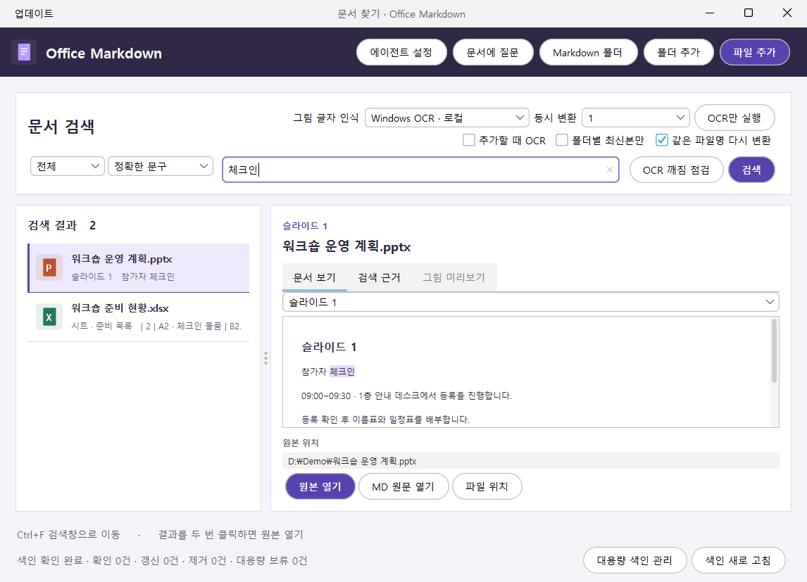

# Office Markdown

Windows에서 PowerPoint, Excel, Word, PDF 파일을 검색용 UTF-8 Markdown으로 변환합니다.

Codex, Claude Code, GitHub Copilot에서 보관함을 검색하고 근거를 인용해 문서 초안을 작성할 수 있습니다. [검색 MCP 연결 방법](docs/MCP_CLIENTS.md)

## 설치하고 첫 문서 찾기

1. **설치하기** — 이 저장소의 **Releases → Assets**에서 Windows x64용 `OfficeMarkdown-버전.msi`를 받아 설치하고, 시작 메뉴에서 **OfficeMarkdown**을 엽니다. Java와 Office를 별도로 설치할 필요는 없습니다.
2. **문서 추가하기** — 오른쪽 위 **파일 추가**로 문서를 선택합니다. 여러 하위 폴더를 한꺼번에 변환하려면 **폴더 추가**를 누르세요. 파일이나 폴더를 창에 끌어놓아도 됩니다.
3. **본문 검색하기** — 변환과 색인이 끝나면 `Ctrl+F`를 누르고 문서에 들어 있는 단어를 입력한 뒤 `Enter`를 누릅니다. 아래 예시에서는 워크숍 자료에서 **체크인**을 검색했습니다. 검색어를 비우면 문서 목록을 최대 500건까지 볼 수 있습니다.
4. **결과 확인하기** — 왼쪽 목록에서 결과를 선택하면 오른쪽 **문서 보기**에 해당 내용이 표시됩니다. **검색 근거**에서 일치한 문장을 확인하고, **원본 열기**로 원래 문서를 엽니다.



## 새 버전으로 업데이트하기

1. 왼쪽 위 **업데이트 → 업데이트 확인**을 선택합니다. 앱을 열 때마다 확인하려면 같은 메뉴에서 **시작할 때 업데이트 확인**을 켜세요.
2. MSI 설치본에 새 버전이 있으면 **다운로드**를 누릅니다. SHA-256 검증이 끝나면 **설치**를 선택하세요. 변환·색인 갱신·문서 질문이 진행 중일 때는 작업이 끝난 뒤 설치할 수 있습니다.
3. Windows 설치 마법사를 마치고 시작 메뉴에서 앱을 다시 엽니다. 2.6.1 이하 버전은 2.7.0 이상의 MSI를 한 번 직접 설치해야 업데이트 메뉴를 사용할 수 있습니다. [설치와 업데이트 안내](docs/INSTALL.md)


## 변환본과 색인 관리

**Markdown 폴더**에서 결과 파일을 복사하거나 다른 검색 도구로 열 수 있습니다. 기본 위치는 `%LOCALAPPDATA%\OfficeMarkdown\Markdown`입니다. 같은 경로의 원본을 다시 추가하면 해당 Markdown을 갱신합니다. 이동한 원본은 새 경로에서 다시 추가하고, 이전 변환본이 필요 없으면 Markdown 폴더에서 삭제하세요.

오른쪽 **문서 보기**에서 변환된 Markdown을 제목·표·목록 서식으로 읽습니다. 위쪽 선택 상자로 슬라이드·시트와 긴 표의 다음 부분으로 이동할 수 있습니다. **검색 근거** 탭에서 검색어가 일치한 문장을 확인합니다.

폴더를 추가하면 탐색 중에는 확인한 항목과 발견한 문서 수를, 변환 중에는 전체 문서 대비 처리 진행률을 표시합니다. **같은 파일명 다시 변환**은 기본으로 켜져 있습니다. 끄면 기존 변환본이나 이번 작업에서 이미 변환에 성공한 문서와 이름·확장자가 같은 파일을 건너뜁니다. 다른 폴더의 동명 파일에도 적용되며 대소문자는 구분하지 않습니다.

앱을 열면 이전에 색인한 문서를 먼저 표시합니다. 파일 변경 확인은 백그라운드에서 진행되며, 그동안 기존 색인에서 검색하거나 파일을 추가할 수 있습니다. 외부에서 수정한 Markdown은 **색인 새로 고침**으로 다시 확인하세요. 폴더 변환 중에는 완료된 문서부터 묶어서 색인하고 진행 상태에 색인 건수를 표시합니다.

**동시 변환**은 기본 1개입니다. **자동(CPU·메모리)**을 선택하면 파일 1개부터 시작해 PC 부하와 여유 메모리에 따라 동시에 처리할 파일 수를 조절합니다. 변환 화면에 현재 적용 중인 한도를 표시합니다. Windows OCR과 OCR 끄기에는 최대 2개로 지정하는 옵션도 있습니다. PaddleOCR는 모델의 메모리와 CPU 사용량을 고려해 자동 한도를 더 낮게 잡고, 비전 API는 1개씩 처리합니다. 선택은 다음 변환 작업에 적용됩니다.

**대용량 색인 관리**는 새로 생성하거나 수정한 Markdown이 100 MB(100,000,000바이트)를 초과하면 기본으로 색인을 보류합니다. 변환본은 Markdown 폴더에 저장됩니다. 목록에서 선택한 파일은 이후에도 자동 색인을 허용합니다. 체크를 해제하면 모든 크기의 파일을 색인합니다. 보류 중인 문서는 검색 결과에서 숨기며, 변경되지 않은 기존 색인은 계속 사용할 수 있습니다. 앱과 OfficeSearch가 같은 설정을 사용합니다.

**폴더별 최신본만**을 켜고 폴더를 추가하면 같은 폴더·확장자의 파일 이름에서 버전 또는 날짜를 비교합니다. 예를 들어 매뉴얼_ver1.10.docx가 매뉴얼_ver1.9.docx보다 최신입니다. 미리보기에서 변환 대상과 제외될 이전판을 확인한 뒤 진행하세요. 최신판을 확정할 수 없는 그룹과 이미 만들어진 변환본은 보존합니다.

## 그림 찾기

1. 파일·폴더 추가 시 기본값은 OCR 끄기입니다. 변환과 동시에 그림을 인식하려면 **추가할 때 OCR**을 체크하고 **그림 글자 인식**에서 방식을 선택하세요. 체크를 끄면 그림은 보존되며 나중에 **OCR만 실행**할 수 있습니다.
2. 검색 범위를 **그림 OCR**로 바꾸고 그림에 보이는 글자를 검색합니다. **모두 포함 (AND)**은 검색어가 모두 들어 있는 그림을 찾습니다. 검색어를 비우면 글자를 인식하지 못한 그림도 포함해 보존된 그림을 확인할 수 있습니다.
3. 목록의 썸네일을 선택하면 **그림 미리보기**가 열립니다. **검색 근거**에서 인식한 글자를 확인할 수 있습니다. **MD 위치 보기**로 해당 그림이 기록된 슬라이드나 시트의 Markdown 위치로 이동하고, **원본 열기**로 원본 문서를 엽니다.

그림 파일은 Markdown 폴더의 `.office-images` 아래에 저장됩니다. 변환본을 다른 위치에서 그림과 함께 읽으려면 Markdown 파일과 해당 `.office-images` 하위 폴더를 같은 상대 경로로 복사하세요.

**OCR만 실행**은 OCR을 끄고 변환한 문서에 그림 인식 결과를 추가합니다. **그림 글자 인식**에서 엔진을 선택하고 **OCR만 실행**에서 기존 Markdown을 선택하세요. 보존된 그림을 사용하므로 원본 파일을 다시 열 필요가 없습니다. 인식 결과가 비어 있어도 완료된 그림은 건너뜁니다. 중간에 중단되면 같은 OCR 방식으로 다시 실행해 남은 그림부터 이어갈 수 있습니다. 이전 버전에서 처리 상태를 기록하지 않은 그림은 글자가 비어 있으면 한 번 처리합니다. 그림이 보존되지 않은 변환본은 원본을 다시 추가하세요.

**OCR 깨짐 점검**을 누르면 저장된 그림 중 인식 문구에 깨짐 징후가 있는 후보를 확인할 수 있습니다. 그림과 기존 문구를 확인한 뒤 원하는 항목을 선택하고 **선택 그림 재인식**을 누르면 로컬 PaddleOCR로 다시 읽습니다. 목록에는 최대 500건이 표시됩니다. 정상 한글처럼 보이는 오인식은 일반 **그림 OCR** 검색에서 직접 선택해 재인식할 수 있습니다. 그림 파일이 보존되지 않은 구버전 변환본은 원본을 다시 추가해 주세요.

## 변환 범위

- PDF는 페이지별 텍스트를 추출합니다. 텍스트가 없는 콘텐츠 페이지는 그림으로 보존하여 변환할 때 또는 나중에 OCR을 실행할 수 있습니다. 텍스트와 그림이 섞인 페이지에서는 텍스트를 추출합니다. 암호가 필요하거나 추출이 제한된 PDF는 오류로 표시합니다.
- Word는 DOCX 본문의 제목·문단·표와 삽입 그림을 변환합니다. 구형 DOC는 본문 텍스트와 추출 가능한 삽입 그림을 변환합니다.
- PPT·PPTX의 텍스트, 표, 그룹 도형 텍스트, 추출 가능한 발표 노트를 읽습니다. PPTX는 그림에 저장된 제목·대체 텍스트와 기본 차트의 제목·계열·저장된 항목 및 수치도 검색합니다. 외부 연결 통합문서를 열어 새 값으로 갱신하지 않습니다.
- XLS·XLSX의 시트별로 원래 행과 열을 Markdown 표로 내보냅니다. 각 값에 셀 주소를 붙이고, 열 범위가 32열을 넘으면 셀 주소와 내용 두 열로 정리합니다. 수식은 파일에 저장된 결과와 수식 자체를 사용합니다.
- XLSX는 시트를 스트리밍으로 읽습니다. 서식만 남은 빈 셀을 모두 메모리 객체로 만들지 않고, 출력할 값과 공유 문자열을 임시 파일에 기록해 대형 문서의 메모리 사용을 줄입니다. 임시 파일은 변환 후 정리합니다.
- Microsoft의 [MarkItDown](https://github.com/microsoft/markitdown) 변환 방식을 참고했습니다. 이 앱은 Apache POI와 PDFBox로 로컬 변환하며, 이전에 추가한 자료는 같은 파일이나 폴더를 다시 추가하면 새 형식으로 갱신됩니다.
- PPTX·XLSX에서 추출한 그림 파일을 보존하고 해당 슬라이드·시트에 상대 경로로 연결합니다. Excel은 그림의 시작 셀 주소가 있으면 함께 기록합니다. 앱에서 해독할 수 있는 그림은 미리보기와 OCR을 지원합니다. 구형 PPT·XLS는 기존 텍스트 변환을 사용합니다.
- 기본 **Windows OCR · 로컬**은 PC의 Windows OCR 언어 팩을 사용합니다. 한글 인식에는 Windows 설정의 한국어 OCR 언어 기능이 필요합니다. **끄기**로 다시 변환하면 그림 파일을 보존하고 OCR 글자는 비워 둡니다.
- **PaddleOCR · 한글 정밀 · 로컬**은 한국어·영어 모델을 PC에서 실행합니다. 작은 글자 등의 정확도를 우선할 때 선택하세요. Windows OCR보다 느리고 메모리를 더 사용합니다. [로컬 설치 안내](docs/RELEASING.md#한글-정밀-ocr-설치)에 따라 한 번 준비하면 인식 중에는 네트워크를 사용하지 않습니다. 기존 변환본은 이 모드로 원본을 다시 추가하면 갱신됩니다.
- **MarkItDown · 비전 API**는 Microsoft 플러그인 `markitdown-ocr==0.1.2`의 이미지 인식 서비스를 호출합니다. 다른 PC에서는 Python 3.10 이상으로 배포 폴더의 `app/ocr/install-vision.ps1`을 한 번 실행합니다. 앱을 실행할 환경에 `OPENAI_API_KEY`와 `OFFICEMD_VISION_MODEL`을 설정하고, 호환 서버 사용 시 `OPENAI_BASE_URL`도 지정하세요. 이 모드로 OCR을 실행하면 목적지와 모델을 확인한 뒤 문서의 그림을 전송합니다. API 요금은 해당 서비스 정책을 따릅니다.
- OCR은 이미지 해상도와 글꼴에 따라 글자를 놓치거나 잘못 읽을 수 있습니다. WMF·EMF·SVG는 앱에서 픽셀 이미지로 변환한 뒤 OCR로 읽습니다. 지원하지 않는 다른 인코딩은 변환 후 알림으로 표시합니다. OCR 실행 실패 시 해당 파일의 이전 변환본을 보존합니다.

## 제목·내용 색인과 AI 검색

앱에서 **전체**, **제목**, **내용** 중 하나를 선택하고 검색어를 입력합니다. 제목은 변환된 Markdown의 첫 제목, 내용은 슬라이드·시트 제목과 본문입니다. 전체 검색은 원본 경로도 포함합니다. 기본값인 **정확한 문구**는 입력한 문자열을 그대로 찾습니다. **모두 포함 (AND)**은 선택한 범위 안에서 모든 단어가 있는 문서를, **하나 이상 (OR)**은 한 단어라도 있는 문서를 찾습니다. 단어는 공백으로 구분하고 대소문자는 구분하지 않습니다. 같은 문서의 다른 줄이나 슬라이드에 있는 단어도 AND 조건을 충족합니다. 빈 검색어는 문서 목록을 표시합니다.

앱과 명령줄은 Markdown 폴더의 로컬 SQLite 색인을 공유합니다. 첫 검색에서 기존 변환본을 등록하고, 이후 검색에서는 파일 목록과 수정 정보를 비교해 추가·수정·삭제를 반영합니다. 한두 글자의 한글도 검색할 수 있습니다.

AI 도구나 스크립트에서는 배포 폴더의 콘솔 프로그램을 실행합니다.

```powershell
.\OfficeSearch.exe --scope content --mode and "AD 어댑터"
.\OfficeSearch.exe --scope title "회의록"
.\OfficeSearch.exe --scope content --limit 20 "서울 매출"
.\OfficeSearch.exe --scope image "사업 계획"
```

표준 출력은 UTF-8 JSON 배열입니다. 각 결과에 `title`, `section`, `excerpt`, `markdownPath`, `sourcePath`가 있습니다. `--scope image` 결과에는 `imagePath`와 `imageLocation`도 있습니다. 일치 항목이 없으면 빈 배열을 반환합니다. 실행 오류는 표준 오류와 종료 코드 1로 전달합니다. 기본 검색 범위는 전체, 기본 한도는 50건입니다. 다른 변환본 폴더는 `--library "폴더 경로"`로 선택합니다.

## 새 PC에서 에이전트 연결

1. 상단 **에이전트 설정**에서 사용할 서비스를 하나 선택합니다. **공식 설치 안내**에서 Windows용 CLI를 설치합니다. 앱은 codex.exe, claude.exe 또는 copilot.exe를 사용합니다.
2. **다시 확인**을 누릅니다. 설치 위치가 잡히지 않으면 **실행 파일 지정**으로 해당 EXE를 선택합니다. **자동 탐색**은 지정 경로를 해제합니다.
3. **로그인 열기**를 눌러 공식 CLI가 띄운 창에서 본인 계정으로 인증한 뒤 **다시 확인**을 누릅니다. 직접 터미널을 사용할 때는 각각 codex login, claude auth login, copilot login을 실행합니다. 계정 비밀번호·토큰은 공급자의 로그인 화면에서 처리합니다.
4. **연결 테스트**는 문서 없이 짧은 요청을 한 번 보냅니다. 로그인 표시가 있어도 실제 구독·권한·사용량에 따라 요청이 실패할 수 있습니다. Copilot은 이 테스트로 확인합니다.
5. **기본 에이전트로 저장**을 누른 뒤 **문서에 질문**을 엽니다. 기본값과 지정 경로는 Windows 사용자별로 유지됩니다.

## 문서에 질문

질문창 위쪽에서 **에이전트 → 모델 선택 → 추론 깊이**를 지정합니다. 모델 목록에서 선택하거나 CLI 모델 ID를 직접 입력할 수 있습니다. **CLI 기본 모델**은 모델 지정을 CLI에 맡깁니다. 아래 입력란에서 Enter는 줄바꿈, Ctrl+Enter는 전송입니다. 전송하면 입력란이 비워져 다음 질문을 작성할 수 있고, 답변 영역에서 검색과 답변 작성 진행 상태를 확인합니다.

질문창의 **추론 깊이**는 해당 질문의 검색어 추출과 답변 작성에 함께 적용합니다. 처음에는 **기본값**이며 선택은 에이전트별로 기억합니다. 현재 모델이 선택한 단계를 지원하지 않으면 **기본값**으로 바꿔 다시 질문하세요.

상단 **문서에 질문**에서 Codex, Claude Code, GitHub Copilot 중 설치·로그인된 Windows CLI를 선택한 후 질문을 입력합니다. 앱은 PATH에서 해당 실행 파일(codex.exe, claude.exe, copilot.exe)을 찾습니다. 별도의 모델 서버나 모델 다운로드는 필요하지 않습니다.

질문을 보내면 에이전트가 관련 검색어를 만들고, 앱이 변환본에서 후보 문서를 찾아 최대 8개 발췌문을 같은 에이전트에 전달합니다. 선택한 서비스의 계정·사용량 정책이 적용됩니다. 답변 아래에서 인용 원문을 확인하고 **원본 열기**로 PPT·Excel 파일을 열거나 **인용 위치 보기**로 앱의 MD 뷰어에서 해당 부분을 확인합니다. 인용 번호와 문구는 앱에서 대조하지만 답변의 해석은 원문으로 확인하세요. 후보에서 근거를 찾지 못하면 검색 범위 또는 질문을 바꿔 다시 시도하세요.

## 다시 빌드하기

소스를 수정하며 이 프로젝트 안에 앱을 설치·실행하려면 [로컬 개발 설치](docs/RELEASING.md#프로젝트-폴더에-설치하고-실행하기)를 참고하세요.

개발 환경 설정, 테스트, 설치본 생성과 다음 버전 배포 절차는 [개발·릴리스 가이드](docs/RELEASING.md)에 있습니다. 설치 위치, 업데이트 및 삭제 방법은 [Windows 설치 가이드](docs/INSTALL.md)를 참고하세요.
