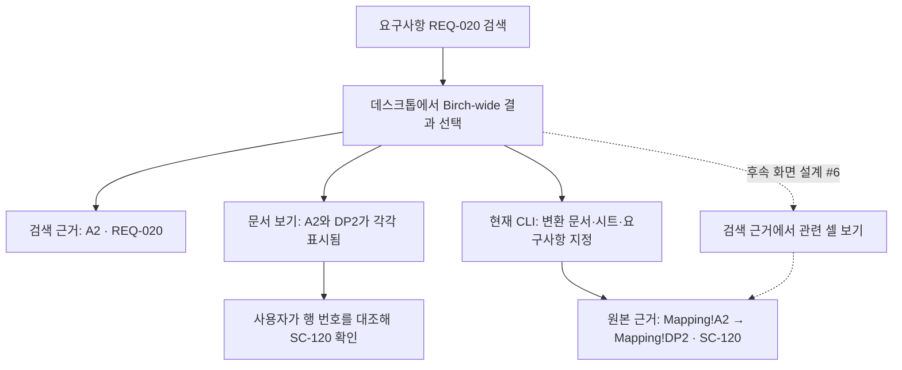

# Excel 셀 근거 조회와 사용 흐름

요구사항 ID가 같은 행에 있는 화면·인터페이스 ID를 시트와 셀 주소로 조회한다. 사용자에게는 검색 근거 한 줄만으로 답이 안 나오는 희소 시트와, 서로 다른 두 문서의 기록을 대조할 때 차이가 생긴다.

가상 자료를 대상으로 데스크톱의 실제 Swing 검색 버튼과 선택·탭 처리기를 구동해 표시 내용을 확인했다. 문서 보기에는 두 셀이 모두 있었고, 검색 근거에는 A2만 있었다. CLI에서는 두 주소를 함께 반환했다. 클릭 수·완료 시간·선호도는 참가자 시험에서 측정할 항목이다.

## 조회

색인된 문서를 기존 검색으로 찾아 결과의 markdownPath를 사용한다. 비교할 문서 두 개를 지정하면 두 경로가 이번 대조의 명시적 범위가 된다. 같은 이름의 파일이나 같은 ID가 있는 다른 문서를 자동으로 추가하지 않는다.

~~~powershell
OfficeSearch.exe --excel-cells SCREEN REQ-020 "$note" Mapping
OfficeSearch.exe --excel-cells INTERFACE REQ-001 "$traceNote" 요구사항추적표 "$designNote" 인터페이스목록
~~~

처음 조회할 때 원본 스냅샷에서 셀 관계를 추출해 로컬 색인에 저장한다. 이후 조회는 원본 지문과 변환 세대를 검증한 뒤 저장 근거를 사용한다. 각 결과에는 원본 위치, SHA-256, 변환 세대, 추출기 버전, 종류, 양쪽 셀 주소가 있다. 시트 식별에는 해당 원본 버전 안에서 유일한 시트 이름을 사용한다. Excel 인용 문법으로 시트 이름 속 작은따옴표를 처리한다.

- 헤더는 요구사항 ID와 화면 ID 또는 인터페이스 ID의 조합으로 찾는다. 공백·줄바꿈·영문 대소문자를 정규화한다. Requirement·Screen·Interface 및 ID 접미 표현도 지원한다.
- 문자로 시작하고 하이픈 또는 밑줄 뒤 숫자로 끝나는 ID를 읽는다. 한쪽 셀에 여러 ID가 있으면 공백·쉼표·세미콜론·슬래시로 나눈다. 같은 관계가 여러 행에 있으면 대상은 하나로 묶고 주소는 모두 보존한다.
- 빈 셀은 빈 기록으로 취급한다. 예시·가이드 시트는 제외한다. 관련 열의 병합·중복 헤더·열 재배치·읽을 수 없는 ID 조합·양쪽 모두 복수 ID인 행은 완전 대조에서 제외한다. 수식과 오류 셀의 값을 추정하지 않는다.
- 두 시트가 모두 COMPLETE이고 버전을 재확인한 경우에만 both·left·right를 반환한다. 시트 또는 헤더 누락, 부분 처리, 읽기 실패, 원본 소실·개정은 INCOMPLETE이며 각 문서 상태에서 이유를 확인한다.

## 정확도와 비용

고정 원본 7개·19문항, 새 JVM과 색인으로 경로별 5회, 실행 순서를 교대했다. 일반 검색은 현재 화면의 검색 경로를 유지하고, 새 방식은 Excel 행·대조 질문에서만 셀 조회를 사용했다.

| 과제 | 기존 | 원본 셀 조회 |
|---|---:|---:|
| Excel 행 완전 일치 | 5/6 | 6/6 |
| Excel 행 F1 | 85.71 | 100 |
| 두 문서 대조 완전 일치 | 3/3 | 3/3 |
| 일반 텍스트·그림 완전 일치 | 6/6 | 6/6 |
| 19문항 조회 p95, 최초 추출 포함 | 25.1 ms | 65.4 ms |

초기 색인 중앙값은 233.8/259.3 ms였고 초기 색인 크기는 양쪽 모두 128 KiB였다. 최초 추출은 관계 조회 시점에 실행한다. 조회 p95는 소형 자료 예산 75 ms 이내였다. 두 경로의 속도 차이는 사용자 작업 시간의 차이로 해석할 수 없다. 가상 자료와 실제 운영 보관함의 규모 차이도 고려해야 한다.

기존 재현 절차에 -ExcelCells를 추가하면 같은 질문과 정답으로 새 경로를 채점한다. [기준선 재현 절차](../qa/wiki-baseline/README.md)
